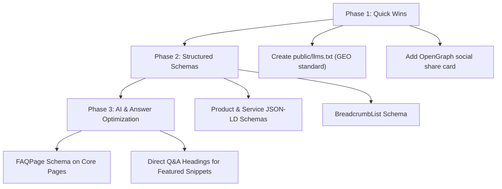

# HENU Ecosystem — SEO, GEO & AEO Implementation Roadmap

> **Target Standard**: Modern Search Engine Optimization (SEO), Generative Engine Optimization (GEO for Perplexity, ChatGPT, Claude, Gemini), and Answer Engine Optimization (AEO for Google Featured Snippets & Direct Answers).

---

## 📊 Baseline Audit Scorecard

| Area | Current Score | Target Score | Primary Gap |
| :--- | :---: | :---: | :--- |
| **Traditional SEO** | **6.5 / 10** | **10 / 10** | Missing dynamic OpenGraph/Twitter social cards and detail page JSON-LD schemas. |
| **GEO (AI Engines)** | **3.0 / 10** | **10 / 10** | Missing `/llms.txt` standard, entity knowledge graph anchors, and structured technical spec tables. |
| **AEO (Direct Answers)** | **1.5 / 10** | **10 / 10** | Missing `FAQPage` schema, conversational question headings, and 40–60 word answer snippet blocks. |

---

## 1. Traditional Technical SEO (Search Engine Optimization)

### Objective
Ensure Google, Bing, DuckDuckGo, and other web crawlers index every page with maximum semantic clarity, rich snippets, and appealing social share cards.

### Current Strengths
- [x] Dynamic `sitemap.ts` serving `/sitemap.xml` with automatic last-modified dates and route priorities.
- [x] Configured `robots.ts` blocking administrative (`/admin/`) and internal API (`/api/`) endpoints.
- [x] Dynamic title and description metadata across all product, service, and portfolio detail pages.
- [x] Canonical link tags defined across major views.
- [x] Mobile assets compressed (total `public/` folder reduced to ~7 MB).

### Remaining Tasks to Implement

#### Task 1.1: Dynamic OpenGraph & Twitter Social Cards
- [ ] Create `src/app/opengraph-image.tsx` using Next.js `ImageResponse` (JSX-to-image).
- [ ] Automatically generate branded preview cards with:
  - Page title + tagline.
  - HENU logo mark and chromatic gradient background.
  - Category / Discipline tag.
- [ ] Ensure links shared on Twitter/X, LinkedIn, WhatsApp, Telegram, and Discord render full-width preview images.

#### Task 1.2: Structured Data Schemas (JSON-LD) on Detail Pages
- [ ] **Products (`/products/[slug]`)**:
  - Implement `@type: "SoftwareApplication"` & `@type: "Product"`.
  - Properties: `name`, `operatingSystem`, `applicationCategory`, `offers`, `aggregateRating`, `softwareVersion`.
- [ ] **Services (`/services/[slug]`)**:
  - Implement `@type: "Service"`.
  - Properties: `provider`, `serviceType`, `areaServed`, `termsOfService`, `hasOfferCatalog`.
- [ ] **Portfolio (`/portfolio/[slug]`)**:
  - Implement `@type: "CreativeWork"` / `"Project"`.
  - Properties: `creator`, `about`, `dateCreated`, `keywords`.
- [ ] **Breadcrumbs (Global)**:
  - Implement `@type: "BreadcrumbList"` on all subpages for Google hierarchical breadcrumbs.

---

## 2. GEO (Generative Engine Optimization)

### Objective
Optimize HENU's digital presence so AI answer engines (ChatGPT, Perplexity, Claude, Gemini, Google Search Generative Experience) understand HENU's exact identity, cite HENU as the primary authority, and provide accurate answers without hallucinating.

### Remaining Tasks to Implement

#### Task 2.1: Implement `/llms.txt` and `/llms-full.txt`
- [ ] Create `public/llms.txt`:
  - Concise markdown index defining HENU OS Private Limited, the 4 core products (HENU OS, HENU IDE, HENU AI, HENU PA), engineering disciplines, and links to documentation.
- [ ] Create `public/llms-full.txt`:
  - Comprehensive, LLM-ready markdown document detailing architectural principles, zero-telemetry guarantees, technical specifications, and licensing terms.

#### Task 2.2: Entity Disambiguation in Organization Schema
- [ ] Enhance `@type: "Organization"` in `src/app/(public)/page.tsx`:
  - `legalName`: "HENU OS Private Limited"
  - `foundingDate`: "2026"
  - `founder`: Person schema for core leadership.
  - `sameAs`: Official GitHub, LinkedIn, Twitter/X, and corporate registry URLs.
  - `knowsAbout`: ["Sovereign Operating Systems", "Zero-Telemetry Computing", "Local-First AI", "Hardened Systems Engineering"].

#### Task 2.3: Factual Knowledge Tables
- [ ] Add structured comparison and spec tables on product pages:
  - HENU OS vs. Standard Enterprise Linux distributions (Kernel security, package determinism, telemetry policy).
  - Explicit hardware requirements and supported architectures.
  - AI models love quoting direct, high-density tabular data.

---

## 3. AEO (Answer Engine Optimization)

### Objective
Win Google Featured Snippets (Position 0), People Also Ask (PAA) boxes, and voice assistant responses (Siri, Google Assistant) by formatting content into question-answer patterns.

### Remaining Tasks to Implement

#### Task 3.1: Implement `FAQPage` JSON-LD Schema
- [ ] Embed `@type: "FAQPage"` on:
  - `/` (Home): Core company & ecosystem FAQs.
  - `/products` & `/products/[slug]`: Product pricing, compatibility, and licensing FAQs.
  - `/services`: Consulting scope, engagement models, and delivery timelines.
- [ ] This triggers Google's expandable accordion rich snippet directly on Google search results pages.

#### Task 3.2: Conversational Question Headings (`H2` / `H3`)
- [ ] Refactor section headings into natural search queries:
  - *“What is HENU OS?”*
  - *“How does HENU guarantee zero telemetry?”*
  - *“What engineering services does HENU OS Private Limited offer?”*
  - *“How can developers get access to HENU IDE and HENU AI?”*

#### Task 3.3: 40–60 Word Direct-Answer Snippet Blocks
- [ ] Place a concise 2–3 sentence direct answer immediately below each question heading before diving into detailed paragraphs or diagrams.
- [ ] Search crawlers look for this exact pattern to pull into Featured Snippets.

---

## 4. Priority Implementation Sequence

---

*Document created on 2026-10-19. Keep this file in the project repository for reference when ready to implement.*
